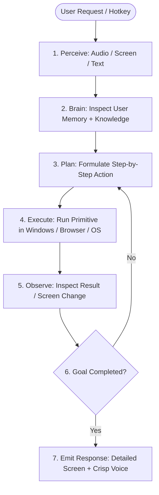
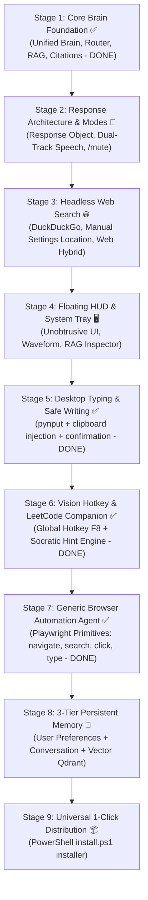

# Thanatos: The Autonomous Desktop "Jarvis" Roadmap & Architecture

This document defines the complete architectural evolution of **Thanatos** from a local RAG assistant into a fully orchestrated, hands-free personal desktop AI assistant ("Jarvis").

---

## 1. System Philosophy: Orchestration Over Features

> **"Don't build 7 disconnected features. Build one cognitive system that happens to have 7 capabilities."**

Thanatos is organized into **five core structural layers**:

```text
                    THANATOS (Core Orchestrator)
                                │
        ┌───────────────────────┴───────────────────────┐
        │                                               │
      INPUT                                           OUTPUT
(Voice / Text / Hotkey)                       (Screen Display / Voice TTS)
        │                                               │
        └───────────────────────┬───────────────────────┘
                                │
                              BRAIN
                                │
        ┌───────────────────────┼───────────────────────┐
        │                       │                       │
     MEMORY                 KNOWLEDGE                 INTENT
(3-Tier Memory)         (RAG / Web / Hybrid)      (Action Classifier)
        │                       │                       │
        └───────────────────────┬───────────────────────┘
                                │
                             EXECUTOR
                                │
       ┌────────────────────────┼────────────────────────┐
       │                        │                        │
    WINDOWS                  BROWSER                   FILES
(Apps / Shortcuts)     (Generic Primitives)     (Typing / Ingestion)
```

The goal is not to add random scripts, but to enable Thanatos to:
1. **Perceive** what the user is doing (Screen, Voice, Hotkey).
2. **Consult Knowledge** (Local RAG, Web, or User Memory).
3. **Plan & Execute** safe actions through clean primitives.
4. **Present the Result Appropriately** (Detailed on-screen, concise through voice).

---

## 2. Core Architectural Decisions

### A. The 3-Tier Memory Architecture
Memory is explicitly partitioned into three specialized stores instead of a single growing list:

```text
Memory Subsystem
├── ConversationMemory   -> Short-term recent dialogue turns ("What did I just ask?")
├── KnowledgeBase        -> Indexed documents, PDFs, manuals in Qdrant + BM25
└── UserMemory           -> Persistent facts ("My name is Gaurav, I code in Python/Rust, I prefer dark mode")
```

### B. The Structured `Response` Object (Dual-Track Output)
The Brain never decides display formatting or TTS audio playback directly. Instead, it emits a standardized `Response` contract:

```python
@dataclass
class Response:
    display_text: str       # Full markdown, code blocks, derivations, tables
    speech_text: str        # 1-2 sentence conversational punchline
    sources: str | None     # Verified source citations
    metadata: dict          # State, latency, confidence score, intent
```

- **Screen / UI Handler** renders `display_text` + `sources`.
- **TextToSpeech Engine** vocalizes `speech_text` using the soothing neural voice.

### C. The Cognitive Agent Loop
Replaces brittle single-shot intent execution with an iterative cognitive cycle:



### D. Security & Side-Effect Confirmation Gate
Actions with external or destructive side-effects must pass through a 2-step preview gate:
- **Safe (Auto-execute)**: App launch, local web search, document retrieval, screen reading, typing into focused app.
- **Potentially Destructive (Requires Preview & Confirmation)**: Sending emails/messages, deleting files, purchasing, posting online, PC shutdown.

---

## 3. Revised Implementation Roadmap



---

### Stage 1: Core Brain & RAG Foundation (Status: ✅ COMPLETED)
- **Implemented & Verified**:
  - `KnowledgeRouter` (3-way classification: `CONVERSATIONAL`, `DOCUMENT_RETRIEVAL`, `HYBRID`).
  - `QueryCondenser` (multi-turn pronoun and ellipsis resolution).
  - Hybrid RAG (Qdrant Dense + BM25 Sparse + Cross-Encoder Reranker + `BetterContext`).
  - Strict citation auditing & low-confidence threshold fallback ($\tau = 0.35$).
  - Streamlined `__main__.py` intent routing; all queries pass through `Brain.respond()`.
  - All 5 end-to-end integration tests in `tests/test_brain_rag_integration.py` passing 100% green.

---

### Stage 2: Response Architecture & Dual-Track Output (Status: ✅ COMPLETED)
- **Goal**: Cleanly decouple what is seen from what is spoken, and provide instant voice/silent toggles.
- **Implemented & Verified**:
  - `src/engine/core/response.py`: `Response` dataclass with `display_text`, `speech_text`, `sources`, and `__iter__` backwards compatibility.
  - `src/engine/brain/brain.py`: Zero-latency `_create_spoken_summary()` punchline extraction with visual cues; `Brain.respond()` returning `Response`.
  - `src/engine/__main__.py`: Added `speak()` audio dispatcher respecting `is_muted`.
  - Added instant `/mute` / `/silent` and `/voice` / `/unmute` commands.
  - Dual-track display in terminal (`response.display_text` + sources) and spoken punchlines (`response.speech_text`).
- **Implementation**:
  1. Define `src/engine/core/response.py`:
     ```python
     @dataclass
     class Response:
         display_text: str
         speech_text: str
         sources: str | None = None
         metadata: dict = field(default_factory=dict)
     ```
  2. Update `Brain.respond(message) -> Response`:
     - Generates comprehensive technical explanation on screen.
     - Synthesizes a crisp 1–2 sentence vocal summary + *"I've displayed the full details on your screen."*
  3. Update `__main__.py`:
     - Screen prints `response.display_text` (and sources).
     - TTS speaks `response.speech_text`.
  4. Quick Mode Switching:
     - `/voice`: Voice input + audio output.
     - `/mute` or `/silent`: Silent text-only mode (no audio).
     - Enter on empty prompt: Activates push-to-talk voice mode.

---

### Stage 3: Headless Web Search & Knowledge Hierarchy (Status: ✅ COMPLETED)
- **Goal**: Answer real-time inquiries (*"Latest version of PyTorch"*, *"Best dosa in Kolkata"*) without launching a browser.
- **Implemented & Verified**:
  - `config.json`: Decoupled user location (`"Kolkata, India"`) and search parameters.
  - `src/engine/web/search.py`: Clean `WebSearchEngine` using modern `ddgs`, automatic *"near me"* location injection, and context/citation formatting.
  - `src/engine/brain/knowledge_router.py`: 4-tier routing (`LOCAL_KNOWLEDGE`, `WEB_SEARCH`, `HYBRID`, `CHAT`) with 0ms keyword fast-path and LLM fallback.
  - `src/engine/brain/brain.py`: Connected live web context into Ollama synthesis and dual-track `Response` with clickable citations.
  - `tests/test_web_search_integration.py`: End-to-end unit and integration test suite verified.
- **Architecture**:
  1. Expand `KnowledgeRouter` into a clean 4-tier hierarchy:
     ```text
     KnowledgeRouter
     ├── LOCAL_KNOWLEDGE (RAG via Qdrant/BM25)
     ├── WEB_SEARCH      (DuckDuckGo headless search)
     ├── HYBRID          (Local notes + Live Web / General Theory)
     └── CHAT            (Direct conversational LLM)
     ```
  2. Implement `src/engine/web/search.py`:
     - Uses `ddgs` to fetch top 3–5 search cards in ~400ms.
  3. Location Configuration:
     - Keep location decoupled from Brain infrastructure.
     - Read default from `config.json`: `{"location": "Kolkata, India"}` (customizable by user).

---

### Stage 4: Floating HUD & System Tray UI (Status: ✅ COMPLETED)
- **Goal**: An unobtrusive, ultra-lightweight desktop companion that stays out of your way while you code.
- **Implemented & Verified**:
  - `src/engine/core/state.py`: Event bus with `subscribe()` callback mechanism and `State.SPEAKING`.
  - `src/engine/core/hotkey.py`: Global system-wide `HotkeyManager` using `pynput` (`<ctrl>+<space>`) with 400ms debounce and `config.json` support.
  - `src/engine/ui/tray.py`: Native Windows System Tray (`pystray`) with in-memory anti-aliased icon, status menu, mute toggle, and `ctypes` terminal show/hide.
  - `src/engine/ui/hud.py`: Borderless, floating translucent pill widget with draggable canvas, pulsing state indicators, and glassmorphism styling (~15MB RAM).
  - `src/engine/__main__.py`: Connected StateManager, HotkeyManager, SystemTrayApp, and FloatingHUD.
  - Test suites (`tests/test_state_events.py`, `tests/test_hotkey.py`, `tests/test_hud.py`, `tests/test_tray.py`) all passing 100%.

---

### Stage 4.5: Advanced Floating HUD & Hands-Free Interaction (Status: ✅ COMPLETED)
- **Goal**: Complete desktop and voice autonomy without needing the terminal window or holding a spacebar.
- **Implemented & Verified**:
  - `src/engine/ui/hud.py`: Expandable Floating Mini-Deck widget (42px pill $\leftrightarrow$ 340px card) with symbol controls (`🔊/🔇`, `🎙️`, `📁`, `⤢/⤡`), scrollable chat log, prompt entry box, and state-reactive Tokyo Night glowing themes (`#7aa2f7`, `#7dcfff`, `#2ac3de`, `#e0af68`, `#9ece6a`).
  - `src/engine/audio/audio.py`: Hands-Free Voice Activity Detection (`record_vad`) with dynamic ambient noise calibration, 250ms circular pre-roll buffer (prevents clipped starting consonants), 800ms pause cutoff, procedural sci-fi wake/sleep chimes, and conversational sleep phrase parser (`is_sleep_command`).
  - `src/engine/audio/clap.py`: Ultra-lightweight acoustic transient `ClapDetector` with crest-factor impulse filtering and double-clap temporal gating ($0.12s \le \Delta t \le 0.75s$) for hands-free acoustic wake-up (`👏 👏`).
  - `src/engine/__main__.py`: Unified non-blocking reactive event loop seamlessly orchestrating terminal stdin, HUD GUI, acoustic claps, hands-free VAD, conversational sleep commands, and full voice/text exit commands (`"exit"`, `"close assistant"`, `"terminate"`).
  - Comprehensive unit test suites (`tests/test_clap.py`, `tests/test_audio_vad.py`, `tests/test_hud.py`, `tests/test_state_events.py`) passing 100%.

---

### Stage 5: Desktop Typing & Safe Writing Automation (Status: ✅ COMPLETED)
- **Goal**: Dictate emails, essays, or notes directly into your active window with safety confirmations.
- **Implemented & Verified**:
  - `src/engine/executor/executor.py`: Implemented `paste_text(text: str)` with Windows Unicode clipboard injection (`CF_UNICODETEXT`) and `pynput` key sequence (`Ctrl + V`).
  - `src/engine/security/validator.py`: Registered `"write_text"` and `"paste_text"` under `SAFE_ACTIONS`; registered `"send_email"` and `"send_message"` under `CONFIRM_ACTIONS` with confirmation prompt previews.
  - `src/engine/brain/brain.py`: Added 0ms fast-path intent matching for `write_text`, `paste_text`, LLM intent classification fallback, and added `draft_text(prompt: str)` with strict raw-text output formatting.
  - `src/engine/__main__.py`: Connected end-to-end action dispatch with thinking state, live console/HUD draft preview, focused window injection, vocal confirmation, and interactive confirmation gate.
  - `tests/test_stage5_typing.py`: Comprehensive test suite verifying security checks, intent mapping, mock clipboard injection, and Ollama drafting passing 100% green.
- **Workflow**:
  1. User says: *"Thanatos, write an email asking for an extension on the project."*
  2. Intent maps to `action: "write_text"`.
  3. LLM drafts the text.
  4. Safe text pasting: copies to clipboard (`pyperclip.copy`) and triggers `Ctrl + V` into the focused text editor.
  5. **Safety Gate**: If the user asks to *send* or *execute* an external action, Thanatos displays a preview and requires verbal/text confirmation (`yes`/`no`) before execution.

---

### Stage 6: Vision Hotkey & LeetCode DSA Companion (Status: ✅ COMPLETED)
- **Goal**: Fullscreen screen-aware algorithmic mentor without Alt-Tabbing.
- **Implemented & Verified**:
  - `src/engine/vision/mentor.py`: Built `DSAMentor` and `MentorResponse` with Socratic prompt engineering across 4 modes (`hint`, `debug`, `complexity`, and `solution`), dual-track technical card formatting, and spoken punchline whisper.
  - `src/engine/core/hotkey.py`: Upgraded `HotkeyManager` to support simultaneous global shortcuts with per-key debouncing (`<ctrl>+<space>` for HUD Mini-Deck, `<f8>` for Vision DSA Mentor) and configuration overrides in `config.json`.
  - `src/engine/security/validator.py`: Registered `"dsa_mentor"` as an allowed `SAFE_ACTIONS` vision routine.
  - `src/engine/brain/brain.py`: Added 0ms fast-path intent matching for algorithmic hints, test-case debugging, time/space complexity, and optimal solution queries with Qwen LLM schema fallback.
  - `src/engine/__main__.py`: Connected end-to-end non-blocking execution via event queue (`vision_mentor`), silent screen grab (`ScreenCapture.capture`), live HUD card display, and Piper TTS headphone whisper.
  - `tests/test_stage6_vision_mentor.py`: Full test suite covering prompt construction, output parsing, mock vision inference, security validation, intent routing, and multi-hotkey debouncing passing 100% green.
- **Iterative Milestones**:
  - **Level 1**: Global hotkey (`F8` or `Ctrl + Alt + Space`) captures screen $\to$ *"What am I looking at?"*
  - **Level 2 (Socratic Hint)**: Identifies the LeetCode problem + user's code, pinpoints the bottleneck, and whispers a 1-sentence algorithmic nudge into headphones without giving away code.
  - **Level 3 (Interactive Debugging)**: Follow-ups: *"Why does this test case fail?"*, *"Show me the time complexity"*.

---

### Stage 7: Generic Browser Automation Primitives (Status: ✅ COMPLETED)
- **Goal**: Headless or visible browser tasks using clean, reusable automation primitives rather than brittle website-specific hacks.
- **Implemented & Verified**:
  - `src/engine/browser/browser_agent.py`: Implemented robust `BrowserAgent` using Playwright with core primitives:
    - `navigate(url)`: Scheme-safe URL validation, domain normalization, and DOM content loaded synchronization.
    - `search(query, engine)`: Multi-engine web search with resilient card/link extraction.
    - `click(selector_or_text)`: Multi-strategy locator resolution (CSS selector, text, button role).
    - `type(text, selector)`: Input typing with optional clear and Enter submission.
    - `extract(selector)`: Structured reading prioritizing `<main>`, `<article>`, and headings.
    - `quick_browse(query_or_url)`: Smart router recipe discerning URLs vs. web queries.
    - `close()`: Clean lifecycle resource teardown and auto-recovery.
  - `src/engine/security/validator.py`: Registered `"browse_url"` and `"browse_web"` in `SAFE_ACTIONS`; added strict URL protocol sanitization blocking dangerous schemes (`file://`, `javascript:`, `data:`, `vbscript:`) and cloud metadata endpoints (`169.254.169.254`).
  - `src/engine/brain/brain.py`: Added 0ms fast-path intent matching for browser commands (*"browse <url>"*, *"visit <domain>"*, *"search on browser for <query>"*) and LLM fallback prompt descriptions.
  - `src/engine/__main__.py`: Connected end-to-end non-blocking execution via `process_user_message` with `State.EXECUTING`, live HUD Mini-Deck preview cards, Piper TTS voice confirmation, and clean shutdown teardown.
  - `tests/test_stage7_browser.py`: Comprehensive test suite verifying URL safety rules, security validator integration, brain intent classification, mock browser primitives, and live headless Playwright navigation passing 100% green.
- **Implementation**:
  - Build `BrowserAgent` using Playwright with core primitives:
    - `navigate(url)`
    - `search(query)`
    - `click(selector_or_text)`
    - `type(text)`
    - `extract(selector)`
    - `close()`
  - High-level streaming / search tasks are built as recipes on top of these primitives.

---

### Stage 8: 3-Tier Persistent Memory (Status: ✅ COMPLETED)
- **Goal**: Cross-session user personalization and continuous learning without cloud dependency.
- **Implemented & Verified**:
  - `src/engine/memory/user_memory.py`: Implemented robust `UserMemory` backed by native SQLite:
    - `user_profile` table for key-value facts (name, language, OS, occupation) with case-insensitive normalization.
    - `user_notes` table for open-ended episodic observations with automatic deduplication.
    - `@contextmanager` safe connection lifecycle management with WAL support and thread-safe locking.
    - `build_context_prompt()`: Compact Markdown context injection block for prompt engineering with negligible token overhead (~25-40 tokens).
  - `src/engine/security/validator.py`: Registered `"save_memory"`, `"recall_memory"`, and `"delete_memory"` in `SAFE_ACTIONS`; registered destructive `"wipe_memory"` in `CONFIRM_ACTIONS` with strict confirmation challenge (`"Thanatos: Proceed? (yes/no)"`).
  - `src/engine/brain/brain.py`:
    - Integrated `UserMemory` with 0ms regex fast-paths for saving facts, recalling identity, and deleting memories.
    - Dynamic injection of user context into LLM system prompts across general chat and web searches.
    - Added Qwen LLM function schema for contextual fallback intent classification.
    - Provided direct brain helper methods (`save_user_memory`, `recall_user_memory`, `delete_user_memory`, `wipe_user_memory`).
  - `src/engine/__main__.py`: Connected end-to-end memory dispatch handlers into the reactive loop with dual-track terminal cards, Tokyo Night Mini-Deck HUD updates, and Piper TTS voice confirmation.
  - `tests/test_stage8_memory.py`: 9 dedicated unit and integration tests covering SQLite CRUD, cross-session persistence, context generation, security validation gates, and intent classification passing 100% green.

---

### Stage 9: Universal 1-Click Terminal Distribution (Status: ✅ COMPLETED)
- **Goal**: Effortless 1-click installation for anyone on Windows.
- **Implemented & Verified**:
  - `install.ps1`: Complete 5-step unattended installer for Windows 10/11:
    - **Step 1 (Pre-Flight)**: Auto-detects Windows, Git, Python 3.10+, and Ollama; auto-installs missing prerequisites via `winget`.
    - **Step 2 (Workspace)**: Clones or links repo directory and prepares `data/`, `logs/`, and `bin/`.
    - **Step 3 (Venv & Dependencies)**: Creates isolated `.venv`, upgrades pip/setuptools, installs `requirements.txt`, registers editable package, and installs Playwright Chromium drivers.
    - **Step 4 (Models & Voice)**: Checks existing local Ollama models (`qwen2.5-coder:7b`, `gemma3:4b`), pulls missing ones without redownload, and downloads Piper TTS voice files.
    - **Step 5 (Global CLI & Shortcuts)**: Creates `bin/thanatos.cmd` and `bin/thanatos.ps1`, registers `bin/` to Windows User `PATH`, and creates a Windows Desktop shortcut.
  - `src/engine/__main__.py`: Built-in CLI argument handling:
    - `thanatos --version`: Instant version information.
    - `thanatos --help`: Complete command manual and hotkey guide.
    - `thanatos --check`: Diagnostic health check verifying Ollama, SQLite memory, Piper TTS, and Playwright browser.
- **1-Click Web Command**:
  ```powershell
  irm https://raw.githubusercontent.com/Gaurav01001/Thanatos/main/install.ps1 | iex
  ```

---

### Stage 10: Clipboard Intelligence & "Smart Fix" (Status: ✅ COMPLETED)
- **Goal**: User-friendly, zero-latency clipboard diagnosis and instant code/prose fix with 0 extra storage dependencies.
- **Implemented & Verified**:
  - `src/engine/clipboard/smart_fix.py`:
    - Native Windows clipboard read/write via `win32clipboard` with safe `ctypes` user32 fallback.
    - Heuristic classification into 4 content types: `traceback`, `json`, `code`, and `prose`.
    - Strict, specialized LLM prompt generation for `qwen2.5-coder:7b`.
    - `parse_smart_fix_response`: Extracts diagnosis, clean replacement text, and 1-sentence vocal summary.
  - `src/engine/brain/brain.py`:
    - Added `Brain.fix_clipboard_content()` method returning structured `SmartFixResult`.
    - 0ms fast-path intent matching for `"smart fix"`, `"fix clipboard"`, `"polish clipboard"`.
  - `src/engine/security/validator.py`: Registered `"smart_fix_clipboard"` as target-less `SAFE_ACTIONS`.
  - `src/engine/core/hotkey.py`: Integrated `<ctrl>+<shift>+v` global hotkey (configurable via `config.json`) with per-key debouncing.
  - `src/engine/__main__.py`: Connected end-to-end event dispatch loop. Places fixed text directly back on user's clipboard ready for `Ctrl+V`, presents formatted diff card to HUD Mini-Deck, and speaks diagnosis via Piper TTS.
  - `tests/test_stage10_clipboard.py`: 11 automated unit tests verifying content classification, prompt building, response parsing, security validation, and hotkey registration passing 100% green.

---

### Stage 11: Elastic Resizable HUD & Minimum Dimension Lock (Status: ✅ COMPLETED)
- **Goal**: Allow dragging the corner or bottom edge to resize the Tokyo Night Mini-Deck (`FloatingHUD`) with strict minimum dimension locks, dynamic responsive header layout, and persistent geometry.
- **Implemented & Verified**:
  - `src/engine/ui/hud.py`:
    - Added configurable `min_width` (default 340px, hard floor 280px) and `min_height` (default 240px, hard floor 180px).
    - `_load_hud_config()`: Automatically loads initial geometry and minimum limits from `config.json` with safe fallbacks.
    - `_save_geometry_to_config()`: Automatically persists user-adjusted width and height back to `config.json` on resize release (`<ButtonRelease-1>`).
    - `set_min_dimensions(w, h)` & `set_dimensions(w, h)`: Strict clamping mathematical guarantees ensuring window never collapses or truncates buttons/logs.
    - Dynamic responsive header (`_draw_pill`): Window controls (expand/collapse, clear, mute, close) adapt dynamically relative to current width (`cur_w - 110`, `- 80`, `- 50`, `- 20`), ensuring buttons stay anchored to top-right at any width.
    - Drag Grips:
      - Interactive visual bottom-right corner grip (`◢`, cursor `size_nw_se`) for simultaneous width and height expansion.
      - Interactive bottom edge resize strip (cursor `size_ns`) for vertical expansion.
      - Uses absolute screen coordinates (`event.x_root`, `event.y_root`) preventing erratic mouse jumping over Tkinter widgets.
  - `config.json`: Added `"hud"` block configuring `"width": 340`, `"height": 240`, `"min_width": 340`, and `"min_height": 240`.
  - `tests/test_stage11_hud_resize.py`: 7 automated unit tests covering config loading, dimension clamping, safety floors, persistence to `config.json`, and simulated drag clamping passing 100% green.

---

### Stage 12: Grounded Live Web Synthesis ("ChatGPT-Style Search & Answer") (Status: ✅ COMPLETED)
- **Goal**: Direct, conversational answers and recommendations for product, price, shopping, and real-time queries with background web grounding (zero browser popups or raw link dumps).
- **Implemented & Verified**:
  - `src/engine/brain/brain.py`:
    - **Intent Classification Disambiguation**: Restricts `browse_web` strictly to explicit browser commands (`"open browser and search"`, `"search in browser"`). All informational questions, product recommendations, advice, reviews, and price lookups route to cognitive `chat`.
    - **Perceptive Web Advisory Synthesis**: In `Brain.respond()`, when routed to `WEB_SEARCH`, harvests background DuckDuckGo snippets and prompts the LLM to deliver 2-3 specific recommendations with realistic prices, pros/cons, and a clear top pick without telling the user to search themselves.
    - **Clean Spoken Output**: Strips markdown formatting symbols (`*`, `#`, bullet dashes) in `_create_spoken_summary()` so Piper TTS reads natural conversational speech without vocalizing asterisks.
  - `src/engine/brain/knowledge_router.py`:
    - Added fast-path keyword recognition for recommendations, products, reviews, and budgets (`"suggest"`, `"recommend"`, `"best"`, `"under rs"`, `"under ₹"`, `"price"`, `"perfume"`, `"specs"`).
    - Regex pattern matching for budget queries (`r"\bunder\s+(?:rs\.?|inr|₹|\$)?\s*\d+"`) routing straight to `WEB_SEARCH`.
  - `src/engine/__main__.py`:
    - **Defensive Guard**: Any ambiguous query that slips through to `browse_web` without explicit browser keywords (`"browser"`, `"chrome"`, `"firefox"`, `"edge"`) is automatically redirected to cognitive web grounding instead of launching Chromium.
  - `tests/test_stage12_web_grounding.py`: 5 automated unit tests verifying shopping/budget routing, browser vs. chat disambiguation, clean speech summary extraction, ChatGPT-style dual-track synthesis, and the defensive browser guard passing 100% green.
